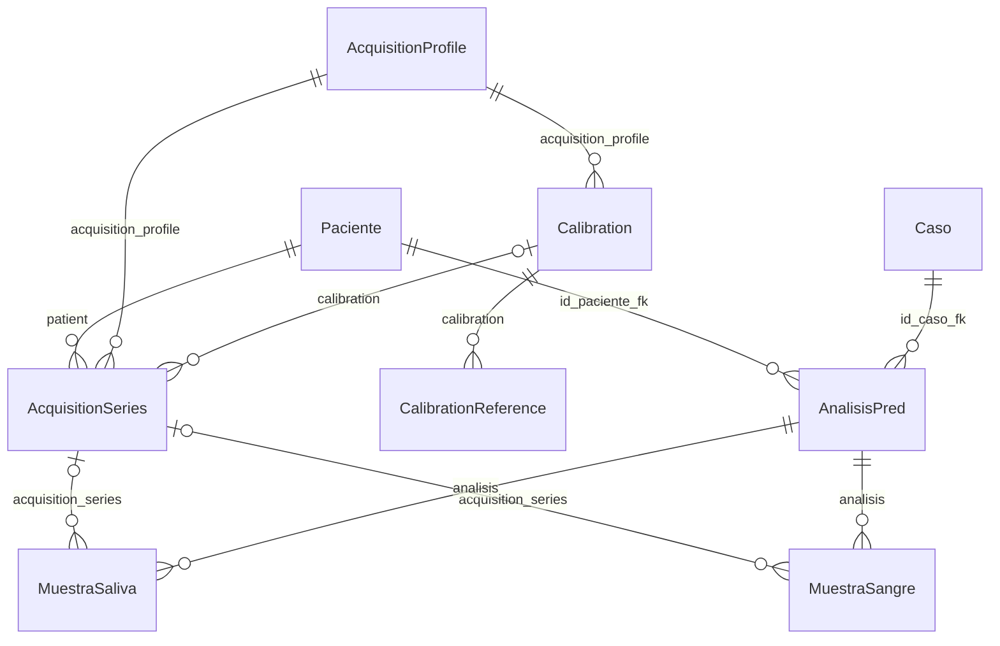

# Sprint 18S-B — Adquisición, calibración y compatibilidad física

## Auditoría previa a cambios

Baseline: `eda9fdaa6a3dcdb155b539f6fb7a89cee40b4783`, rama `master`, working tree
limpio. 18S-A y 18S-A.1 commiteados. Django check sin incidencias y migraciones
api 0001–0009 aplicadas.

Relaciones reales inspeccionadas:

- Paciente (`id_paciente`): identidad identificada/pseudonimizada; `display_name`
  y helper `patient_identity.py` ya resuelven presentación/identificación.
- Caso (`id_caso`) → Paciente, CASCADE; número opcional único por paciente.
- AnalisisPred (`id_analisis`) → Paciente y Caso, CASCADE. Serializer verifica
  coherencia caso/paciente; estados Abierto/En proceso/Cerrado.
- MuestraSaliva y MuestraSangre son tablas separadas (`id_muestra`), cada una con
  FK `analisis` CASCADE, `imagen` ImageField y `fecha_subida`.
- Storage de originales: `muestras/saliva/%Y/%m/` y `muestras/sangre/%Y/%m/`,
  bajo MEDIA_ROOT. No hay campos width/height ni caché de dimensiones en muestras.
- Resultados → muestras; revisiones y caracterizaciones conservan relaciones
  históricas. ImageJImportRecord protege paciente/caso/muestra/resultado y TIFF.
- Los serializers actuales usan campos `__all__`; uploads no exigen serie.
  No existe una abstracción de imagen única implementada. ADR-003 es una propuesta
  histórica, no el esquema vigente: no se aplica esa generalización en este sprint.
- Viewsets/rutas actuales `/api/muestras/`, `/api/muestras-sangre/`, pacientes,
  casos y análisis no declaran permisos propios; DRF usa defaults (AllowAny).
  No se cambia globalmente esa política. Las nuevas rutas de adquisición exigirán
  autenticación y la nueva asociación no se permitirá mediante escritura anónima.
- El motor `services/calibration/` es Python aislado, sin persistencia. Se reutiliza
  su contrato de escala/provenance; no se cambia su algoritmo ni se ejecutan nuevas
  calibraciones reales para poblar la BD.

## IMPORTANT PENDING — 18S-A.2

**IMPORTANT_PENDING_18S_A2**. PROVISIONAL es operativamente utilizable por decisión
expresa del investigador; no equivale a VALIDATED científicamente.

Falta repetir adquisiciones, evaluar repetibilidad, obtener especificación y
tolerancia/certificado del patrón, adquirir a 0° y 90°, estudiar anisotropía,
revisar incertidumbre metrológica y fijar criterios científicos PASS/REVIEW/FAIL.
La calibración provisional deberá sustituirse o promoverse con evidencia posterior.
Esta deuda no se resuelve en 18S-B.

## Modelo implementado



Los cuatro modelos están en `api/acquisition_models.py`, reexportados desde
`api.models`; no se duplica ningún modelo registrado. `AcquisitionSampleMixin`
es abstracto y sólo comparte FK/validación; no crea otra tabla de muestras.

| Entidad | Campos y decisiones |
|---|---|
| AcquisitionProfile | `name`, fabricantes/modelos de microscopio y cámara, `adapter_model`, `objective_magnification`, `image_width_px`, `image_height_px`, `image_mode`, `binning_x/y`, `notes`, `created_at/updated_at`. Sólo nombre y resolución son obligatorios. Óptica desconocida puede quedar vacía. Magnificación/binning opcionales y positivos. |
| Calibration | FK profile PROTECT, `label`, `status`, `scale_x_um_per_px`, `scale_y_um_per_px`, `source_width_px/height_px`, `method`, `algorithm_version`, `provenance` JSON, notas y timestamps. Dimensiones idénticas al perfil y escalas estrictamente positivas. |
| CalibrationReference | FK calibration PROTECT, patrón `GRADUATED_GRID/CIRCLE`, filename, SHA-256, dimensiones, dimensión conocida, escalas medidas nullable, `measurement_status`, `diagnostics` JSON, `source_image` opcional y `created_at`. Un patrón ambiguo puede conservarse sin escala medida. `MEASURED` exige ambas escalas y resolución coherente con calibración. |
| AcquisitionSeries | FK patient/profile PROTECT, calibration nullable PROTECT, `label`, `acquisition_date` opcional, notas y timestamps. Varias series por paciente; no se inventa unicidad de etiqueta o idempotencia durable. |
| MuestraSaliva / MuestraSangre | `acquisition_series` nullable PROTECT; cada imagen tiene como máximo una serie. Una misma serie puede contener ambos tipos. No hay backfill. |

Escalas/dimensión conocida usan `DecimalField(max_digits=24, decimal_places=15)`.
La API recibe/emite decimales como strings. La prueba de persistencia SQLite verifica
exactamente `0.055233934047693` y `0.055010060892106` (valores sintéticos para test,
no una calibración real insertada). SQLite almacena valores numéricos con precisión
binaria limitada: no se promete aritmética decimal arbitraria de 24 dígitos; para
magnitudes microscópicas actuales se preservan más de 12 decimales útiles. No se
realizan conversiones físicas en este sprint.

Las restricciones SQL protegen escalas/dimensiones positivas y estados válidos.
Las reglas entre tablas e inmutabilidad se ejecutan en `clean` y en `save` transaccional.
Se validan también los PATCH sobre una copia del estado completo. Django no ejecuta
`full_clean` automáticamente con `save`; aquí se invoca expresamente para las
cuatro entidades nuevas. Las muestras mantienen sus validaciones anteriores y
sólo añaden el guard de adquisición. [Validación de instancias Django](https://docs.djangoproject.com/en/5.0/ref/models/instances/#validating-objects).

## Trazabilidad e integridad

- Un perfil con calibraciones/series no permite editar campos físicos. Nombre/notas
  siguen editables. Otro montaje/resolución requiere un perfil nuevo.
- Escalas, dimensiones, perfil, método, versión y provenance de Calibration son
  inmutables desde su creación. Para nuevos valores se crea otra calibración.
- Estados: PROVISIONAL por defecto; se permite PROVISIONAL → VALIDATED o RETIRED,
  y VALIDATED → RETIRED. RETIRED es terminal. Ningún proceso promueve automáticamente.
  La API permite la decisión explícita autenticada; no puede verificar por sí misma
  que la evidencia metrológica sea suficiente para VALIDATED.
- Las referencias existentes son inmutables; se añaden evidencias sólo mientras la
  calibración siga PROVISIONAL y no esté asignada a una serie. Una calibración nueva
  debe recibir sus referencias antes de utilizarse. Nueva evidencia posterior se
  conserva con una nueva calibración; no se reescribe el historial.
- La imagen de referencia es opcional. Si se carga, se verifican SHA-256, dimensiones,
  decodificación y límites de Pillow antes de almacenarla sin transformación en
  `calibration/references/<calibration_id>/<uuid>.<ext>`. Se compensa el archivo nuevo
  si falla su inserción en BD. La metadata sin archivo no permite verificar sus
  bytes: representa evidencia declarada, no verificación física de un archivo ausente.
- Una serie fija paciente/perfil desde su creación. Puede nacer sin calibración y
  recibir una posteriormente; una vez asignada, no se puede retirar/reemplazar la FK.
- Una muestra puede recibir serie después del upload. Una vez asociada, se impide
  cambiar serie, imagen o análisis para evitar reinterpretar su adquisición histórica.
  Una adquisición distinta se representa con otra muestra/serie.
- `sample → analisis → paciente` debe coincidir con `series.patient`. Un análisis con
  muestras vinculadas tampoco puede cambiar de paciente. Esto cubre SALIVA y SANGRE.
- No se expone DELETE de las nuevas entidades. Las relaciones PROTECT impiden borrar
  perfiles/calibraciones/series/pacientes referenciados por esta estructura.
- Se usan transacciones y locks de padres/filas al guardar. `QuerySet.update`, bulk
  writes y SQL directo no son mecanismos de dominio soportados: omiten validaciones
  entre tablas. SQLite no ofrece locks de fila; una carrera puede abortar con bloqueo
  de BD y debe reintentarse explícitamente después de releer. No se promete un servicio
  de edición concurrente/idempotencia avanzada en este sprint.

## Compatibilidad y estados

`api/services/acquisition/compatibility.py` expone:

- `physical_compatibility(sample)`: contexto estructurado, sin persistencia.
- `can_use_physical_units(sample)`: booleano derivado del mismo contexto.

El contexto contiene `compatible_for_physical_units`, `status`, `reasons`,
`acquisition_series_id`, `calibration_id`, `calibration_status`, `profile` y
`source_dimensions`. Sólo cuando es compatible añade `scale_x_um_per_px` y
`scale_y_um_per_px`. Las escalas bloqueadas nunca se devuelven para uso físico.

| Estado | Significado |
|---|---|
| COMPATIBLE | Relaciones/dimensiones/archivo correctos y Calibration VALIDATED. |
| COMPATIBLE_PROVISIONAL | Mismas comprobaciones, pero estado PROVISIONAL visible y operativamente utilizable. |
| NO_ACQUISITION_SERIES | Muestra histórica sin asociación; mediciones actuales en píxeles intactas. |
| NO_CALIBRATION | Serie existe, todavía sin calibración. |
| CALIBRATION_RETIRED | Vínculo histórico conservado; bloqueadas nuevas conversiones físicas. |
| PROFILE_MISMATCH | Perfil de calibración distinto al de serie. |
| RESOLUTION_MISMATCH | Dimensiones de calibración/perfil/imagen no coinciden exactamente. |
| PATIENT_MISMATCH | Paciente derivado de análisis distinto al de serie. |
| INVALID_IMAGE | Original ausente, ilegible, inválido, truncado o fuera de límites de Pillow. |
| IMAGE_MODE_MISMATCH | Perfil declara un modo Pillow, como RGB, distinto al original. Si no se declara, no se restringe. |
| INVALID_CALIBRATION | Defensa ante un estado no reconocido; las escrituras normales ya lo rechazan. |

Se devuelven las causas en orden determinista: serie, paciente, calibración,
perfil, estado, dimensiones declaradas, archivo, dimensiones reales y modo.
Un bloqueo previo no obliga a leer el original (por eso `source_dimensions` puede
ser null). Se leen relaciones frescas para evitar usar una calibración retirada
que quedó cacheada en el objeto de Python.

Pillow abre el original mediante su storage, verifica y decodifica bytes; no usa
miniaturas, DPI, EXIF para inferir escala, transpose, resize ni campos cacheados.
4928×4928 contra perfil 4928×4928 puede pasar; 2464×2464 queda bloqueada y **no**
recibe escala multiplicada por dos. No se modifican los bytes. El modo es opcional
y debe usar el código Pillow exacto; cámara, objetivo, adaptador y binning son datos
**declarados por el operador**, no propiedades verificadas automáticamente en JPEG.

**RETIRED_RECALCULATION_POLICY = PENDING_DECISION**. La referencia histórica se
conserva para reproducibilidad, pero nuevas conversiones quedan bloqueadas. 18S-D
necesitará guardar ID/estado/escalas de la calibración usada junto a sus resultados;
consultar compatibilidad no equivale a una reserva ni una escritura científica.

## API y upload existente

Todas las rutas nuevas exigen `IsAuthenticated` con autenticación Session/Basic
actual de DRF; no se introduce AllowAny ni se cambia la política global de Registro.
No hay roles por paciente configurados en el sistema: estos endpoints están dirigidos
a operadores autenticados, no a un esquema multi-tenant. [Permiso IsAuthenticated](https://www.django-rest-framework.org/api-guide/permissions/#isauthenticated).

| Ruta bajo `/api/` | Métodos |
|---|---|
| `acquisition-profiles/` y `<id>/` | GET list/detail, POST, PUT/PATCH |
| `calibrations/` y `<id>/` | GET list/detail, POST, PUT/PATCH de metadata/status dentro de las reglas |
| `calibration-references/` y `<id>/` | GET list/detail, POST; PUT/PATCH no puede alterar evidencia existente |
| `acquisition-series/` y `<id>/` | GET list/detail, POST, PUT/PATCH dentro de las reglas |
| `acquisition-compatibility/SALIVA/<sample_id>/` | GET |
| `acquisition-compatibility/SANGRE/<sample_id>/` | GET |

Payloads usan los nombres reales de los campos: `patient`, `acquisition_profile`,
`calibration`, `label`, `acquisition_date`. FKs son IDs. Referencias aceptan JSON
sin archivo o multipart con `source_image`. No hay nombres de patrones/archivos reales
hardcodeados ni llamadas al motor desde las APIs. Errores de validación devuelven 400;
DELETE no está disponible (405). No hay cambios de frontend ni API científica existente.

Los uploads de `/api/muestras/` y `/api/muestras-sangre/` conservan `analisis`/`imagen`
y aceptan omitir serie. El campo nullable adicional se muestra en respuestas y puede
asignarse por un operador autenticado mediante multipart. Escritura anónima del vínculo
es rechazada; el upload histórico sin vínculo conserva su comportamiento. Esto prepara
18S-C sin exigir serie al flujo de Registro actual.

## Migración y respaldo de trabajo

Migración `api/0010_acquisition_calibration.py`, sólo esquema: cuatro tablas nuevas,
constraints y dos FK nullable; sin RunPython ni carga/backfill de datos.

Aplicada el 2026-10-21 después de tests/checks y respaldo verificado. Estado previo
0001–0009; posterior 0001–0010 aplicado. `makemigrations --check --dry-run`:
**No changes detected**. No se modificaron migraciones previas.

- BD resuelta mediante settings: `apps/web/Backend/db.sqlite3`.
- MEDIA_ROOT resuelto: `apps/web/Backend/media`.
- Respaldo: `/tmp/sicam18sb_backup_20261021T135229Z/database/db.sqlite3`.
- SHA-256 original previo:
  `c85adc2b66d77a5b10fb8603a97bf3c06997d07fb6cf4b8d89a1bae41fb63609`.
- SHA-256 backup:
  `306d70991bd8e194a941ae4f03a573dd69a67f1c7fe34908d71012387cf89942`.
- Ambos tienen 4,489,216 bytes. Se usó la API de backup SQLite consistente: los hashes
  físicos pueden diferir por metadata interna de SQLite; se verificó igualdad completa
  de filas/columnas de **todas** las tablas y legibilidad/integridad del respaldo.
- `manifest.json`, `hashes.txt`, `media_manifest.json` y `RECOVERY.md` junto al backup.
  Media no se copió: se registró manifiesto de todos sus archivos/hashes, como solicita
  el alcance. 88 archivos, 703,174,139 bytes, hashes idénticos después de la migración.
- Evidencia técnica sin datos clínicos: `/tmp/sicam18sb/pre.json`, `post.json`,
  `media_pre.json`, `migration.log` e `integrity.py`. Los manifiestos locales contienen
  rutas de storage, no se versionan ni se adjuntan archivos de pacientes.
- Guard inmediatamente anterior: BD y media siguen coincidiendo con el snapshot.
  No había procesos Python de aplicación ejecutándose al comprobar el entorno.
- Integridad SQLite pre/backup/post: `ok`; foreign_key_check vacío.

| Tabla relevante | Antes | Después |
|---|---:|---:|
| Paciente | 7 | 7 |
| Caso | 7 | 7 |
| AnalisisPred | 7 | 7 |
| MuestraSaliva | 63 | 63 |
| MuestraSangre | 2 | 2 |
| ResultadoSegmentacion | 27 | 27 |
| RevisionSegmentacion | 27 | 27 |
| ResultadoCaracterizacion | 22 | 22 |
| ImageJImportRecord | 23 | 23 |
| SegmentationExecution | 25 | 25 |
| Cada uno de los cuatro modelos nuevos | inexistente | 0 |

Se compararon hashes canónicos de todas las columnas históricas, incluidas geometrías,
provenance, JSON y timestamps. También se preservaron usuarios, sesiones y demás tablas
existentes. Las 65 muestras tienen FK nueva null. Las únicas filas añadidas son metadata
normal de Django: 1 migration, 4 content types y 16 permisos. Las filas anteriores de
esas tres tablas también permanecen idénticas. No se creó perfil OPTIKA, calibración
actual, referencia real ni serie; tampoco hubo nuevas copias en media.

## Pruebas y alcance verificado

Comandos desde Backend con Python del entorno `sicam`:

```bash
python manage.py test --noinput
python manage.py check
python manage.py makemigrations --check --dry-run
python manage.py showmigrations api
```

- Suite backend completa: **306 tests OK**, 33 nuevos de adquisición y 273 previos.
  Incluye motor 18S-A/18S-A.1 (29), Registro, ImageJ, Segmentación/selectiva,
  normalización, revisiones/effective y Characterization 2.1. Sólo BD de tests y
  media sintética temporal; ninguna segmentación/calibración científica real ejecutada.
- Adquisición: modelos/positividad/precisión, ambos tipos de muestra, series sin
  calibración, perfil incompatible, paciente incompatible, modificación del paciente
  del análisis, inmutabilidad, estados, retiradas, delete protegido, APIs autenticadas,
  upload legacy y asociación opcional, referencias/hash/storage y compensación ante
  fallo simulado de inserción. Archivos inválidos/ausentes, modo incompatible y defensa
  ante fixtures inconsistentes creadas deliberadamente fuera de los servicios.
- Casos 4928×4928 PROVISIONAL/VALIDATED y 2464×2464 contra perfil 4928×4928: PASS.
  Prueba bloquea explícitamente llamadas a `Image.resize`, comprueba que no se entregan
  escalas al mismatch y que original/calibración no cambian.
- Frontend con Node 24.17.0, sin cambios de código:
  `node tests/registration.test.mjs`: **40 PASS**;
  `node tests/segmentationStrategies.test.mjs`: **59 PASS**;
  `node tests/characterization21.test.mjs`: **22 PASS**.
- Django check: sin incidencias. SQL integrity/FK: PASS. `git diff --check`: PASS.

Logs fuera del repo: `/tmp/sicam18sb-backend-tests.log`,
`/tmp/sicam18sb-registration.log`, `/tmp/sicam18sb-segmentation.log`,
`/tmp/sicam18sb-characterization.log`.

## Límites y próximos pasos

No se cambió el motor de calibración, Characterization, normalizador, microservicios,
frontend, requirements ni datos científicos existentes. No se convirtió área, perímetro,
distancias, centroides o GLCM a unidades físicas; no hay recalculo ni corrección de
anisotropía/distorsión. No se implementó idempotencia durable.

18S-C podrá crear/seleccionar perfiles, registrar calibración y sus evidencias,
crear series por paciente, asignarlas a lotes y consultar compatibilidad. Debe usar
las validaciones de dominio y autenticación; no hacer bulk updates que las omitan.
La carga y asociación real del perfil OPTIKA y de los pacientes exige el paso controlado
posterior; no está ejecutada aquí.

18S-D podrá consumir `physical_compatibility(sample)` para obtener sx/sy e ID/estado
cuando `can_use_physical_units(sample)` sea verdadero. Deberá congelar esa trazabilidad
en el resultado físico y definir la política de concurrencia/retiro durante cálculos.

No se encontró un roadmap/TODO científico central activo; la deuda 18S-A.2 se mantiene
visible en este documento sin crear archivos TODO redundantes. Los documentos de
arquitectura/roadmap de sprints iniciales no se convierten en un segundo backlog.

Estado técnico: completado, sin commit/push/staging. La validación experimental
**18S-A.2 sigue pendiente importante**; este sprint no certifica la calibración real.

**SPRINT 18S-B = PASS WITH DEFERRED SCIENTIFIC VALIDATION**
